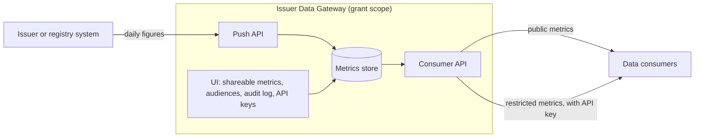

# Issuer Data Gateway

## Development Fund Proposal

| Field | Value |
| :---- | :---- |
| Organization | Kaiko |
| Author / Primary Contact | Charles Desmonty, Kaiko ([@Desmonty-Kaiko](https://github.com/Desmonty-Kaiko)) |
| Status | Draft |
| Created | 2026-10-22 |
| Proposal Type | RFP-aligned |
| RFP / Roadmap Area | Financial Markets, Standards & Verification: [RFP 11, Public verifiability](../../2026-2028-strategic-roadmap.md#financial-markets-standards--verification) |
| Champion | Charles Desmonty, Kaiko ([@Desmonty-Kaiko](https://github.com/Desmonty-Kaiko)), Financial Workflows & Composability SIG |
| Total Funding Request | Up to 8,791,667 CC: 7,491,667 CC for Milestones 1 to 4 and up to 1,300,000 CC in adoption payments ($1,055,000 at a $0.12 baseline, each payment adjusted to a 7-day TWAP) |
| Project Duration | 20 months: first DA Utility issuers in production by month 8, then 12 months of maintenance and adoption |
| Label | financial-workflows-composability (SIG: Financial Workflows & Composability) |

---

## Abstract

Canton keeps holdings and transfers private, so the supply, holder and activity figures on which tokenised assets are evaluated exist only at the asset issuer. Each issuer decides what it shares and with whom, and each data consumer (explorer, analytics platform, index or data provider) needs the same figures in the same format from every issuer. Today each pair settles this through a separate integration, and issuers' compliance teams need a record of what is shared, and with whom, before they approve.

Kaiko would build the Issuer Data Gateway, open-source software (Apache-2.0) through which an asset issuer shares data about its Canton instruments with the consumers it chooses. It works in three steps:

1. **Feed.** The issuer's system, or its registry's, pushes daily figures from a fixed catalogue: total supply, holders, mints, burns, transfers and an instrument descriptor.
2. **Choose what is shareable.** In the gateway's UI, the issuer's approver selects, per instrument, which catalogue metrics can be shared.
3. **Choose who reads what.** Each shareable metric is opened to the public or to named consumers. The issuer issues each consumer's API key, limits it to the metrics it grants and revokes it at any time. Every change is logged.

Consumers read one Consumer API, the same on every gateway. An issuer and a consumer agree directly on what is shared, without an intermediary.

Each issuer chooses how its gateway runs: self-hosted on its own infrastructure, or managed by a hosting provider such as Kaiko. In both cases only the issuer decides what is shared and issues the keys. DA Utility is the design partner: its registry gets an option that feeds a client's gateway, and its clients are the first issuers in production. The grant funds the open-source release, its rollout and a year of maintenance: 7,491,667 CC ($899,000 at $0.12 per CC), plus up to 1,300,000 CC paid per issuer publishing and per consumer integrating in production.

---

## RFP Alignment and Ecosystem Need

**RFP.** RFP 11 seeks proposals that progress Canton toward public verifiability of key metrics, and its first approach is standardised tooling for asset issuers, decentralised issuers included, to publish public aggregates of activity and value. This proposal is that tooling: one metric catalogue, one API specification and one conformance suite, shipped as software any issuer runs or has hosted. The roadmap lists aggregate metrics with selective disclosure among the options for public verification of private transactions; sharing per metric and per audience is that selective disclosure.

**Trust.** RFP 11 notes that a market may not trust an aggregate published by an issuer. The tooling narrows that gap without disclosing transactions: every gateway applies the same definitions; the party that computes and pushes the figures answers for them; total supply, name, symbol and decimals can be checked against the registry's Token Metadata API; restatements stay visible in the history; and the read-only part of the conformance suite runs against any public endpoint. The other approaches RFP 11 lists, TEE disclosure and proofs of aggregate data, can later attest figures computed under the same definitions.

**Secondary fit.** RFP 20 covers network activity reporting and deployable on-premise or hosted visibility tools. The four data questions it asks are answered under [Data and privacy](#data-and-privacy).

**Requirements on both sides.** Issuers differ in what they are willing to share, and consumers differ in what they need and how they read it. The gateway connects the two as follows.

| Side | Requirement | How the gateway meets it |
| :- | :- | :- |
| Issuer | Willingness to share differs per issuer, per instrument and per consumer | Per instrument, the approver sets the shareable metrics, then the audience of each: public or named consumers. Everything else stays with the issuer. |
| Issuer | Compliance approves only with a record of what is shared and with whom | Audit log of every sharing change and key event, with export; external audit report and security documentation pack. |
| Issuer | As little as possible to deploy and build | An issuer that prefers to deploy nothing has its gateway hosted. A DA Utility client enables the registry option that feeds its gateway; other issuers use the reference backend, which posts figures from a database or a spreadsheet. |
| Issuer | Control of access, whoever hosts the gateway | Only the issuer's approvers issue, scope and revoke API keys. A hosting provider runs the infrastructure and takes no part in sharing decisions. |
| Consumer | The same definitions and format from every issuer | One metric catalogue, one OpenAPI specification and one conformance suite for every gateway. |
| Consumer | Coverage that varies per issuer must be explicit | Each response states whether a metric is published, opted out or has no data. |
| Consumer | Latest values for display, history for analytics | Latest-value and history endpoints, backfilled history, TypeScript and Python SDKs. |
| Consumer | A cheap first integration | Public metrics need no key, and a public sandbox serves test data. |
| Both | Needs beyond catalogue v1 | A new metric is proposed in the public repository and ships as a new catalogue version; published definitions keep their meaning. |

**The network.** Canton assets appear in the cross-network figures on which tokenised assets are evaluated.

**Adoption.** The DA Utility registry integration goes to production in Milestone 3, with its first clients publishing through their gateways. Adoption payments are made only per issuer publishing in production and per consumer integration.

---

## Specification

### Objective

**Problem.** A Canton asset issuer has no standard way to share data about its instruments under its own control, and data consumers have no common definitions or API to read it.

**Intended outcome.** A release that an issuer runs itself or has hosted, through which it shares a fixed catalogue of metrics with the audiences it chooses; the DA Utility registry feeding its clients' gateways in production; consumers reading the same Consumer API on every gateway.

### Implementation Mechanics

A gateway belongs to one issuer, and every role in its UI is the issuer's.

- **Administrator.** Registers instruments and users, and authorises the system that pushes figures.
- **Approver.** One per instrument. Decides which metrics are shareable, issues each consumer's API key and sets what it reads.

A **data consumer** reads the Consumer API: public metrics without a key, restricted metrics with the key the issuer gave it. A hosting provider, where there is one, runs the infrastructure and has no role in the UI.

Each gateway has five parts.



- **Push API.** The only way data enters. The system that holds the records, the issuer's own or its registry's data service, computes the figures and posts them against the metric catalogue.
- **Metrics store.** Every accepted value and its history, with retention settings, backups and export.
- **UI.** Instruments; per instrument, the shareable metrics and the audience of each; revocation; an audit log.
- **API keys.** Issued by the issuer's approvers, one per consumer, limited to the instruments and metrics they grant, rotated or revoked at will, with usage logs and rate limits.
- **Consumer API.** One OpenAPI specification for every gateway. Each response states whether a figure is published, opted out or has no data.

#### Sharing model

The approver decides per instrument, in two steps: which catalogue metrics are shareable, then which audience reads each one, the public or a consumer's key. An example for one instrument and two consumers:

| Metric | Shareable | Public | Explorer A's key | Analytics platform B's key |
| :- | :-: | :-: | :-: | :-: |
| `total_supply` | Yes | Yes | Yes | Yes |
| `holders` | Yes | | Yes | |
| `mints`, `burns` | Yes | | Yes | Yes |
| `transfers` | No | | | |

The issuer and each consumer agree between themselves on the metrics the consumer needs, and the approver issues the consumer's key with that scope. Every gateway offers the same catalogue, so a consumer's integration is the same whichever subset an issuer grants.

#### Metric catalogue v1

The catalogue is the gateway's data model: the full list of what an issuer can share, defined with DA Utility on the token standard so that every gateway serves the same data. Version 1 has five metrics and an instrument descriptor. Definitions are written against the token standard V2 account model (CIP-0112), where mints and burns are transfer legs from and to the instrument admin's special accounts, and cover V1 (CIP-0056) assets through the V1 rules in the table. They are stated in terms of the holdings and the event log of the instrument admin. The party that computes and pushes the figures answers for their accuracy: DA for DA Utility clients, the issuer otherwise. Total supply, name, symbol and decimals match the Token Metadata API, so a consumer can cross-check them against the registry's endpoint.

| Metric | Definition | Unit | Window |
| :- | :- | :- | :- |
| `total_supply` | Units outstanding at the window close | Instrument units | Daily cut at 00:00 UTC, hourly optional |
| `holders` | Accounts with an owner holding a positive balance at the window close. The instrument admin's special accounts are excluded, and a V1 holding counts as its owner's basic account. | Count | Daily cut |
| `mints` | Issuance legs from the instrument admin's special accounts into owner accounts, and units issued. In V1, the issuer's issuance records. | Count and units | 24 hours to the cut |
| `burns` | Redemption or destruction legs from owner accounts into the instrument admin's special accounts, and units removed. In V1, the issuer's redemption records. | Count and units | 24 hours to the cut |
| `transfers` | Transfer legs between owner accounts, netted legs and moves between one owner's accounts included; merges, splits, mints and burns excluded. A V1 transfer counts as one leg. | Count | 24 hours to the cut |
| `instrument` | Instrument ID (admin party and ID), name, symbol, decimals, issuer, registrar, asset class, token standard versions supported | Descriptor | On change |

Definitions are versioned: a published definition keeps its meaning, and a change ships as a new catalogue version.

#### Push API and Consumer API

Two small surfaces: one the issuer's or registry's system writes to, one consumers read from.

| Push endpoint | Purpose |
| :- | :- |
| `POST /v1/ingest/records` | Metric records for one or more instruments |
| `POST /v1/ingest/instruments` | Create or update instrument descriptors |
| `POST /v1/ingest/backfill` | History in bulk, validated like live records |
| `GET /v1/ingest/status` | Last accepted window per instrument and metric |

- **Idempotence.** The same instrument, metric and window sent twice is stored once; a different value is a restatement, kept in the history.
- **Validation.** Known metric and unit, window aligned to the UTC cut, non-negative values.
- **Conformance.** A conformance suite checks that a gateway implements the specification: response shapes, publication states, key scoping, idempotent writes, restatements and validation errors. Issuers and hosting providers run it against their own gateways, and its read-only part runs against any public endpoint.

| Consumer endpoint | Returns |
| :- | :- |
| `GET /v1/instruments` | Published instruments, with descriptors |
| `GET /v1/instruments/{id}/metrics` | Latest value and state of each metric |
| `GET /v1/instruments/{id}/metrics/{metric}/history` | Series between two dates |
| `GET /v1/status` | Specification version, health |

Public metrics need no key. Everything else takes an API key in a header, with a rate limit per key. A latest-values response:

```json
{
  "instrument": "example-usd",
  "spec_version": "1.0",
  "metrics": [
    {"metric": "total_supply", "window_end": "2026-09-30T00:00:00Z", "value": "12500000.00", "state": "published"},
    {"metric": "holders", "window_end": "2026-09-30T00:00:00Z", "value": null, "state": "opted_out"}
  ]
}
```

#### Deployment

One release, two ways to run it, chosen by each issuer. Approvers and consumers see the same UI and the same Consumer API in both, and in both only the issuer's approvers decide what is shared and issue keys. What differs is who runs the infrastructure and holds the figures.

| | Self-hosted | Managed |
| :- | :- | :- |
| Run by | The issuer, on its servers or cloud account | A hosting provider: Kaiko, or any other running the same release |
| Figures held by | The issuer | The provider, as processor |
| Sharing choices and API keys | The issuer | The issuer |
| Terms | Apache-2.0 licence | Service and data agreement between the issuer and the provider |
| In this grant | The release | Outside: a commercial service on the same release |

**Self-hosted, funded by this grant.**

- Push API, metrics store, UI and Consumer API ship as container images and a Helm chart, for the issuer's servers or cloud account.
- The issuer alone holds the figures, the sharing records and the keys. Kaiko has no access, and the only terms between them are the Apache-2.0 licence.
- The issuer applies releases, runs backups and answers for availability. The status endpoint reports the running version, and the project supports the two latest minor versions.
- History stays in the issuer's database for as long as the issuer keeps it. Scheduled backups and a full export ship with the release.
- The issuer's security team reviews the open code and its own gateway, with the external audit report and the security documentation pack funded by this grant.

**Managed, outside this grant.** Kaiko hosts one isolated tenant per issuer and holds its figures as a processor, under a service and data agreement with the issuer: processing only for the issuer's API, retention and deletion periods, security obligations and audit rights, an availability SLA, and export and deletion on exit. The issuer stays the golden source: only the system it authorises pushes, and only its approvers share and issue keys. Any other provider can offer the same hosting.

**Feeding a gateway.** Figures enter through the Push API, over HTTPS, from a system the issuer authorises, wherever the gateway runs.

- **Registry option.** DA Utility adds an option to its registry that pushes a client's figures to the client's gateway, self-hosted or managed. The client builds no data pipeline.
- **Issuer's own system.** The issuer computes the figures from its records and posts them, or uses the reference backend to post them from a database or a spreadsheet.
- **Provider with ledger access.** A provider that reads the issuer's party, through the issuer's Ledger API or by hosting the party on its own participant in observation mode, can compute the figures and push them. This path is designed separately from this grant and leaves the gateway and its APIs unchanged.

#### Data and privacy

- **Data required.** Daily aggregates per instrument from catalogue v1, and instrument descriptors. No party identifiers, positions or transactions.
- **Data class.** Application-provided. The issuer's system, or its registry's, computes the figures from its own records and pushes them; the release reads nothing node-local or publicly observable.
- **Protocol metadata.** None is used, so changes to what the Mediator or other protocol messages expose do not affect the release.
- **Privacy, access controls and selective disclosure.** Nothing is published without the approver's consent, per metric and per audience. Public metrics are readable without a key; restricted metrics only with a consumer key scoped to instruments and metrics. Consent and keys can be revoked at any time, and the audit log records every consent change and key event. Self-hosted, the figures are served only from the issuer's infrastructure.

### Architectural Alignment

- **Token standard.** The definitions follow the V2 account model of CIP-0112 and map V1 (CIP-0056) holdings onto it, so one catalogue covers both versions. Instruments are identified by their instrument ID (admin party and ID), which both versions use. Total supply, name, symbol and decimals follow the Token Metadata API, which CIP-0112 keeps at v1.
- **Privacy model.** Holdings and transfers stay private. Only the aggregates an issuer approves are shared, through its gateway.
- **Footprint.** The release is an off-ledger service next to the issuer's or registry's existing systems. It needs no Daml package, no ledger writes and no changes to Splice or Canton.
- **Roadmap.** It provides the aggregate-metrics path the roadmap lists for public verification of private transactions.

**Related work.**

| Existing work | What it does | Relationship |
| :- | :- | :- |
| Canton Asset Data Feed, Fairmint ([#890](https://github.com/canton-foundation/canton-dev-fund/pull/890), open, RFP 11) | Open, pull-based feed format for asset-level metrics, with daily declarations on Canton | Complementary layer. CADF defines how public metrics are published and anchored; the Issuer Data Gateway is the issuer-side system that ingests figures, applies the issuer's sharing choices and serves public and keyed endpoints. Catalogue v1 is offered to CADF as its tokenised-asset profile, and CADF's reference publisher can read a gateway's Consumer API as its data source. |
| Token Metadata API (CIP-0056, kept by CIP-0112) | Current instrument facts per registry, including total supply where the registry reports it | Same identifiers and definitions. The Issuer Data Gateway adds history, holders, flows, sharing controls and keys. |
| DA Utility | Registry service for assets that DA's clients issue on Canton | Design partner. DA adds a registry option that pushes a client's figures to the client's gateway, and its clients are the first issuers in production. Each client chooses a self-hosted or a managed gateway. |
| Third-party data access, Digital Asset ([documentation](https://docs.digitalasset.com/third-party-data-access)) | Gives a provider party-level visibility of an issuer's transactions, through the issuer's Ledger API or through party replication to the provider's participant | Different grain. That access serves providers that need transactions, such as compliance monitoring and accounting. The gateway shares approved aggregates, per metric and per consumer, and gives no ledger access. A provider holding such access can compute catalogue figures and push them to the issuer's gateway. |

### Backward Compatibility

*No backward compatibility impact.* The release is a new off-ledger service. It writes nothing to the ledger and changes no Splice, Canton or token standard package.

---

## Milestones and Deliverables

### Milestone 1: Core release and metric catalogue v1

- **Estimated Delivery:** month 4 after approval
- **Focus:** the five components, the catalogue and its specification, and a public sandbox.
- **Deliverables / Value Metrics:**
  - Push API, metrics store, UI, API keys and Consumer API, released under Apache-2.0 in a public repository.
  - Metric catalogue v1 with its methodology, and the OpenAPI specification.
  - API conformance suite.
  - Public sandbox with test data.
- **Acceptance:** token standard maintainers have reviewed the catalogue and specification against the stable V2 API, with the review recorded publicly; the sandbox is live at a public URL and passes the conformance suite.

### Milestone 2: Production readiness and external audit

- **Estimated Delivery:** month 6 after approval
- **Focus:** what issuers' operations and security teams need before production.
- **Deliverables / Value Metrics:**
  - Operator features: SSO, roles, alerting, audit export.
  - Deployment tooling: Helm chart, Terraform, upgrades, backups.
  - Consumer SDKs for TypeScript and Python.
  - Reference backend that posts figures from a database or a spreadsheet.
  - Hardening, an external code audit with retest, and a security documentation pack for issuers' compliance reviews.
- **Acceptance:** the audit report is published, with every critical and high finding fixed and retested; the release is tagged with its Helm chart, and the SDKs are published.

### Milestone 3: DA Utility in production

- **Estimated Delivery:** month 8 after approval
- **Focus:** the DA Utility registry integration and the first issuers in production.
- **Deliverables / Value Metrics:**
  - DA Utility's registry option live in production, feeding its first clients' gateways, self-hosted or managed.
  - Documentation, operator runbooks and two workshops for issuer operators and consumers.
- **Acceptance:** at least one DA Utility client's production gateway, fed by the registry option, serves catalogue metrics for at least one instrument through the Consumer API, confirmed in writing by DA; documentation and runbooks are published and both workshops are held.

### Milestone 4: Maintenance and consumer onboarding

- **Estimated Delivery:** quarterly, months 8 to 20
- **Focus:** keep the release current and bring consumers onto it.
- **Deliverables / Value Metrics:**
  - Patches and release support on the two latest minor versions, including updates for token standard changes.
  - Onboarding of explorers, analytics platforms and dashboards as consumers.
  - A public quarterly report: releases, fixes, known deployments and consumers.
- **Acceptance:** each quarter, maintained releases are published and the quarterly report is posted.

### Adoption payments

- **Estimated Delivery:** as they occur, months 8 to 20
- **Issuer:** an issuer publishes at least one catalogue metric for at least one instrument on its production gateway, self-hosted or managed, for 30 consecutive days, confirmed in writing by the issuer. Each issuer counts once.
- **Consumer:** a named third party (explorer, analytics platform, dashboard, index or data provider) reads a production deployment through the Consumer API and shows or uses the figures in its production product, confirmed in writing. Kaiko and its affiliates do not count.

---

## Acceptance Criteria

The Tech & Ops Committee will evaluate completion based on:

- Deliverables completed as specified for each milestone
- Demonstrated functionality or operational readiness
- Documentation and knowledge transfer provided
- Alignment with stated value metrics

Project-specific conditions:

- Each milestone's **Acceptance** line is its payment gate, checked from published evidence or written confirmation.
- A deployment counted for Milestone 3 or for an adoption payment passes the read-only conformance checks, and a reviewer designated by the Committee can read its figures through a public metric or a reviewer key.
- A counted deployment serves catalogue metrics only: no party identifiers, positions or transactions.

---

## Sustainability

- Issuers run their own gateways or have them hosted, by Kaiko or another provider.
- Kaiko maintains the open-source release for 12 months after Milestone 3, under Milestone 4.
- Afterwards, Kaiko keeps maintaining the release it runs, unmodified, for its managed customers. The specification and catalogue stay in the public repository, versioned so that published definitions keep their meaning.

---

## Funding

**Total Funding Request:** up to 8,791,667 CC ($1,055,000 at the $0.12 baseline): 7,491,667 CC ($899,000) for Milestones 1 to 4, and up to 1,300,000 CC ($156,000) in adoption payments.

### Payment Breakdown by Milestone

Each payment is due on Committee acceptance.

| Milestone | Due | USD baseline | CC at $0.12 |
| :- | :- | -: | -: |
| Milestone 1: Core release and metric catalogue v1 | Month 4 | $462,000 | 3,850,000 |
| Milestone 2: Production readiness and external audit | Month 6 | $311,000 | 2,591,667 |
| Milestone 3: DA Utility in production | Month 8 | $52,500 | 437,500 |
| Milestone 4: Maintenance and consumer onboarding | Quarterly, months 8 to 20 | $73,500, or $18,375 per quarter | 612,500, or 153,125 per quarter |
| Adoption: issuer publishing in production | As they occur, up to 10 | $12,000 each | 100,000 each, up to 1,000,000 |
| Adoption: consumer integration | As they occur, up to 4 | $9,000 each | 75,000 each, up to 300,000 |
| **Total** | | **up to $1,055,000** | **up to 8,791,667** |

### Cost Basis

| Work package | FTE-months | Cost | Milestone |
| :- | -: | -: | :- |
| Push API: validation, idempotent writes, backfill | 3.5 | $73,500 | 1 |
| Metrics store: history, restatements, retention, export | 4 | $84,000 | 1 |
| UI: instruments, consent per metric and audience, audit log | 4.5 | $94,500 | 1 |
| API keys: scoping, rotation, usage logs, rate limits | 2.5 | $52,500 | 1 |
| Consumer API: OpenAPI specification, publication states | 3.5 | $73,500 | 1 |
| Metric catalogue, methodology and API conformance suite | 3 | $63,000 | 1 |
| Public sandbox with test data | 1 | $21,000 | 1 |
| Operator features: SSO, roles, alerting, audit export | 4 | $84,000 | 2 |
| Deployment tooling: Helm, Terraform, upgrades, backups | 1.5 | $31,500 | 2 |
| Consumer SDKs, TypeScript and Python | 1 | $21,000 | 2 |
| Reference backend: posting from a database or a spreadsheet | 1.5 | $31,500 | 2 |
| Hardening and audit remediation | 2.5 | $52,500 | 2 |
| External code audit with retest | | $80,000 | 2 |
| Security documentation pack for issuers' compliance reviews | 0.5 | $10,500 | 2 |
| Documentation, operator runbooks, two workshops | 1 | $21,000 | 3 |
| Project management and specification governance | 1.5 | $31,500 | 3 |
| Consumer onboarding: explorers, analytics platforms and dashboards | 1 | $21,000 | 4 |
| Open-source release maintenance, 12 months | 2.5 | $52,500 | 4 |
| **Total** | **39** | **$899,000** | |

39 FTE-months at $21,000 come to $819,000; the external code audit with retest adds $80,000, for $899,000. $21,000 per FTE-month covers loaded engineering cost with overhead for Kaiko France staff, in line with the approved CAPS grant ([#497](https://github.com/canton-foundation/canton-dev-fund/pull/497)): 9 FTE for 6 months at 9,850,000 CC, about $21,200 per FTE-month at its $0.116 baseline. Maintenance is 2.5 FTE-months spread over twelve months, for patches and release support on the two latest minor versions; it covers the code, and operating a deployment is priced separately as the managed service.

### Volatility Stipulation

CC amounts are computed at a baseline of $0.12 per CC. Each disbursement is adjusted using the 7-day time-weighted average CC/USD price (TWAP) immediately preceding its acceptance date, so that each payment keeps its baseline USD value, as in the approved CAPS grant (#497). The Committee designates the price source; Kaiko's own CC/USD feed is used only if the Committee chooses it. If the Committee prefers fixed CC, the baseline amounts apply, with the re-evaluation at the 6-month mark that the proposal template sets for projects longer than six months.

---

## Co-Marketing

Upon release, Kaiko will collaborate with the Foundation on:

- Announcement coordination for the open-source release (Milestone 1) and for the first production deployment (Milestone 3), with DA Utility's agreement
- A technical blog on sharing issuer data from a private network, and a case study of the DA Utility integration
- Developer and ecosystem promotion through the public sandbox, the SDKs and the two workshops

---

## Motivation

Tokenised assets are compared on supply, holders and activity. On public chains these figures come from the ledger; on Canton, only the issuer can supply them. Without a standard way to do so, Canton assets are absent from the explorers, analytics platforms, dashboards and indices where markets form views, or reach them through one-off integrations that each issuer and each platform must build and review.

With one release and one catalogue, an issuer decides what it shares and with whom, changes that decision at any time and keeps the record its compliance team asks for. A data consumer integrates once and reads every gateway the same way, whatever subset each issuer grants. The issuer and the consumer deal with each other directly. The first issuers in production are DA Utility clients, fed by their registry; the release is open to every token standard registry, V1 (CIP-0056) and V2 (CIP-0112), including decentralised issuers.

---

## Rationale

- **Push only.** The issuer's system, or its registry's, already holds the records and computes the figures. Pushing keeps the release free of ledger access and of each issuer's data model, so it runs the same for every issuer, self-hosted or managed, and the issuer stays the golden source.
- **A fixed catalogue, filtered by the issuer.** Issuers select from a known data model, so every gateway serves the same API while each issuer shares a different subset with each consumer.
- **Self-hosted or managed, the issuer's choice.** Self-hosted, the issuer alone holds its figures, sharing records and keys, and Kaiko is not a party to its data. Managed hosting serves issuers that prefer to deploy nothing, with the same release and API.
- **The issuer controls access.** Sharing choices and API keys are set only by the issuer's approvers, in a self-hosted and in a managed gateway alike.
- **One catalogue, one API.** Consumers integrate once, and the conformance suite keeps deployments consistent across versions.
- **Aggregation stays with consumers.** Each gateway serves its issuer's figures; combining issuers is a consumer's job.
- **Alternatives considered.** A Kaiko-hosted aggregator holding every issuer's data would make Kaiko a party to each issuer's data agreements and take publication control away from issuers. An attestation service with on-ledger verification adds weight that the first approach of RFP 11 does not require; CADF anchoring and the RFP's TEE and proof approaches cover that need. A ledger connector built into the release would need access to the issuer's participant and its data model, and would differ per issuer; a provider with read access to the issuer's party can feed the Push API from outside the release.
- **Extending what exists.** The release reuses the token standard's instrument IDs and the Token Metadata API's definitions and can feed CADF. It adds the issuer-side layer: history, flows, sharing controls and keys.

---

## Team

Kaiko provides digital-asset market data and benchmarks; it is an EU BMR benchmark administrator and holds a SOC 2 Type 2 report. On Canton, Kaiko operates a Super Validator, publishes the CC/USD feed that Super Validators can follow for their Amulet conversion rate votes, and authored the Kaiko Data Standard ([#113](https://github.com/canton-foundation/canton-dev-fund/pull/113), approved May 2026).

Kaiko France employees deliver the project: an engineering manager, backend, frontend, DevOps and integration engineers, and a product manager. Charles Desmonty, product manager and solution architect for Kaiko's Canton products, leads it.

---

## Disclosure

- The Canton Foundation took part in Kaiko's Series B extension in September 2026.
- Kaiko operates a Super Validator and publishes a CC/USD feed; the Volatility Stipulation leaves the choice of price source to the Committee.
- The author is a member of the Token Standards / Asset Standards and Financial Workflows & Composability SIGs and is also this proposal's champion.
- Outside this grant, Kaiko offers managed hosting of the release and may read gateways for its own data products, with issuers' keys, like any consumer.
